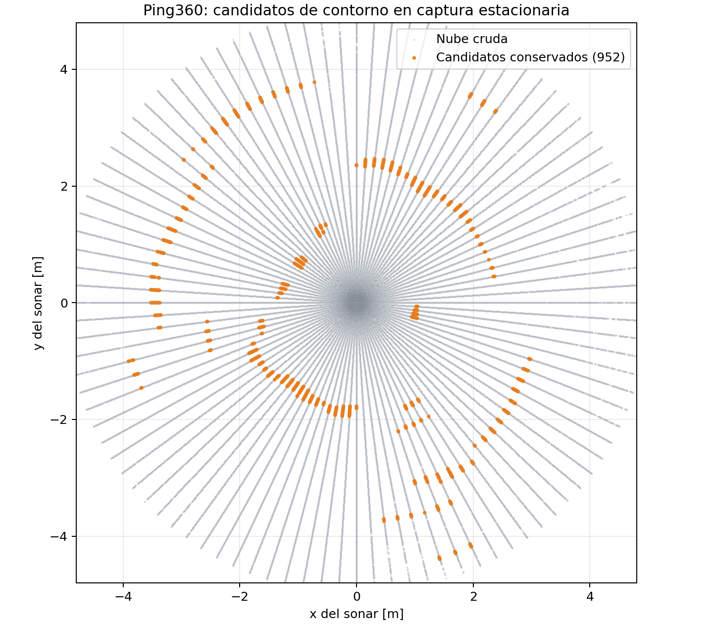

# Filtro de contorno Ping360 v0.6.6 — ROS 2 Jazzy

Esta versión está orientada a conservar arcos de ecos coherentes de una piscina rectangular de 4 × 2 m. Busca contraste radial, descarta componentes pequeñas o estrechas y limita los candidatos del contorno a un radio configurable de 2.0 m, sin superar además el máximo físico definido por la diagonal de la piscina más 0.15 m. El filtro conserva candidatos geométricos; no clasifica de forma definitiva cada arco como pared.

Las pruebas están expuestas como `unittest.TestCase` para que `colcon test` las descubra en ROS 2 Jazzy.

## Salidas

- `/ping360/points_filtered` (`PointCloud2`): retornos candidatos del contorno.
- `/ping360/filtered_points` (`PointCloud2`): alias para el dashboard existente.
- `/ping360/pool_contour_status` (`String`): JSON con cobertura, cantidad de direcciones coherentes y rango usado.
- `/ping360/real_scan` (`LaserScan`): vista polar de los retornos conservados.
- `/ping360/filter_stats` (`String`): estadísticas de cada nube procesada.

El filtro no publica velocidades ni objetivos para el controlador. Un retorno coherente puede provenir de un objeto dentro de la piscina; esta primera versión todavía no clasifica cada segmento como pared. El filtro de contorno ignora los retornos a más de 2.0 m. Esto mejora la percepción local durante el recorrido; el extremo lejano de la piscina de 4 m solo aparecerá cuando el sonar se acerque a menos de 2 m.

## Límite durante el movimiento

Cada mensaje del bag contiene la nube 360° completa. El nodo espera una vuelta de 15 s para acumular la primera captura y luego procesa cada nube entrante. La salida queda expresada en el marco local del sonar y marca `motion_compensated=false`. Los rosbags no tienen posición ni orientación sincronizadas; por eso, al desplazarse el UUV durante una vuelta, el contorno puede deformarse. La validación geométrica de la piscina se debe hacer con el sub quieto.

## Instalación

Descarga `ping360_pool_contour_v066_ros2_jazzy.zip` en `~/Descargas` y ejecuta:

```bash
cd ~/Descargas
mkdir -p ping360_filter_ws/src
unzip -q -o ping360_pool_contour_v066_ros2_jazzy.zip -d ping360_filter_ws/src
cd ~/Descargas/ping360_filter_ws
source /opt/ros/jazzy/setup.bash
colcon build --symlink-install --packages-select ping360_filter --event-handlers console_direct+
colcon test --packages-select ping360_filter --event-handlers console_direct+
colcon test-result --verbose
source install/local_setup.bash
```

## Prueba con rosbag

Terminal 1:

```bash
cd ~/Descargas/ping360_filter_ws
source /opt/ros/jazzy/setup.bash
source install/local_setup.bash
ros2 launch ping360_filter filter.launch.py \
  use_sim_time:=true contour_max_range_m:=2.0
```

Terminal 2, usando una grabación de piscina:

```bash
source /opt/ros/jazzy/setup.bash
ros2 bag play \
  ~/Escritorio/ROS_2/Robotx_PUCP/UUV_ws/real_ws/recordings/ping360/ESPERAR_MISMA_POSICION \
  --clock
```

En RViz deja visibles únicamente `Raw Ping360` y `Filtered Echoes` para comparar los ecos crudos con los filtrados.

Terminal 3:

```bash
source /opt/ros/jazzy/setup.bash
ros2 topic echo /ping360/pool_contour_status
```

La piscina de 2 × 4 m tiene diagonal de 4.472 m. El filtro de contorno aplica el radio local configurable `contour_max_range_m: 2.0` y, en cualquier caso, no excede la diagonal más el margen de 0.15 m. El análisis offline de `docs/analysis_summary.md` corresponde al límite anterior de 4.622 m; sirve como referencia histórica, no como validación de este nuevo radio. Las capturas de desplazamiento y giros sirven para revisar el comportamiento local del sonar, pero no permiten compensar el movimiento ni reconstruir un contorno fijo de la piscina.



## Reproducción sin RViz

Para verificar la publicación y el caudal del filtro sin abrir RViz, lanza el nodo directamente:

```bash
source /opt/ros/jazzy/setup.bash
source ~/Descargas/ping360_filter_ws/install/local_setup.bash
ros2 run ping360_filter ping360_filter_node --ros-args \
  -p use_sim_time:=true \
  -p contour_max_range_m:=2.0
```

En otra terminal reproduce el bag con `--clock` y revisa `/ping360/filter_stats` y `/ping360/pool_contour_status`. Debe empezar a publicar tras la primera vuelta de 15 s.


Corrección v0.6.3: define el periodo de rotación antes de evaluar el calentamiento, evitando el cierre del nodo al recibir nubes con timestamp.

Cambio v0.6.5: fija el radio predeterminado del contorno en 2.0 m y permite indicarlo en la orden de ejecución.

Cambio v0.6.6: hace más selectiva la etapa existente: conserva componentes con al menos 16 puntos y 15° de extensión angular para entregar candidatos más sólidos al proceso de seguimiento. Las interfaces y los tópicos de salida se mantienen.
