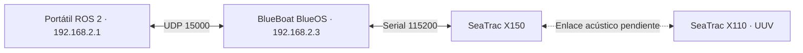

# SeaTrac USBL

## Arquitectura



BlueOS funciona como puente serial-UDP. El protocolo SeaTrac y la lógica ROS 2
se ejecutan en `SYSTEM_ws`; el driver no ordena movimiento a ningún vehículo.

## Compilar y ejecutar

```bash
cd "$HOME/Escritorio/ROS_2/Robotx_PUCP/SYSTEM_ws"
source /opt/ros/humble/setup.bash
colcon build --symlink-install
source install/setup.bash

ros2 launch seatrac_ros2 usbl.launch.py
```

## Interfaces

Temas principales:

```text
/seatrac/system_info_raw
/seatrac/status_raw
/seatrac/status
```

Servicios principales:

```text
/seatrac/environment/read
/seatrac/environment/apply
/seatrac/settings/save
/seatrac/calibration/reset_magnetometer
/seatrac/calibration/calculate_magnetometer
```

Existen perfiles `freshwater` y `seawater`. Cargar el YAML cambia parámetros
ROS; `/seatrac/environment/apply` aplica la configuración de trabajo. La
escritura persistente está bloqueada por defecto con
`allow_persistent_save=false` para evitar desgaste y cambios accidentales.

El transporte X150 y la lectura de estado fueron validados en banco. El enlace
X150-X110, el ranging y el posicionamiento USBL requieren pruebas en agua.
